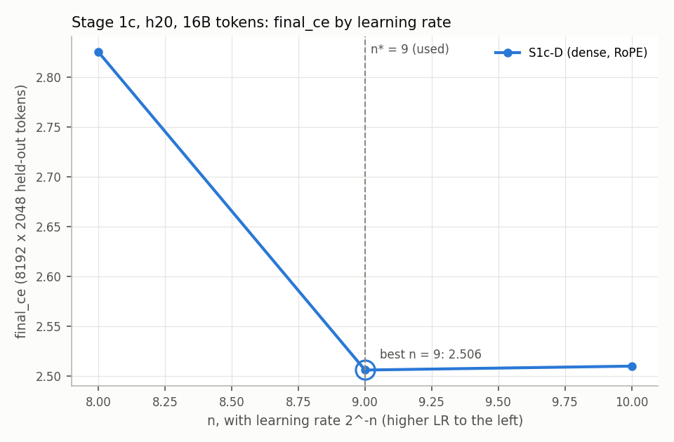
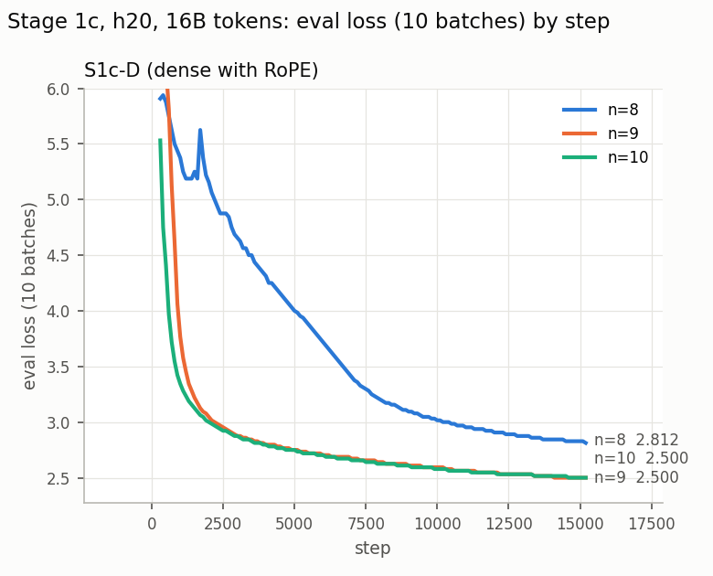

# Stage 1c — dense h20 at 16B tokens, on 4 GPUs: report

**Status: complete (2026-11-09 07:29). Dense h20's best learning rate is n_d\* = 9, inside
the grid: `final_ce` 2.5059, against 2.5098 at n = 10 and 2.8252 at n = 8
([Result](#result)). So Stage 2c trains n = 8, 9 and 10, plus n = 7 once AME's best
landed on n = 8 ([stage_2c_report.md](stage_2c_report.md)). The runs moved from Helios to LEM
at 18:16 on 2026-11-08, at Maciej's instruction: Helios goes down for maintenance, with its
GPUs off until the end of the month (decision 6). No Helios job had started. The grid ran
on LEM from 18:50 on 2026-11-08 to 07:24 on 2026-11-09. n = 11, started early while n = 10
led (decision 12), was cancelled at 07:29, before it started (decision 14).**

The plan is [ame_experiments.md, "Stage 1c — dense h20 at 16B tokens, on 4 GPUs"](ame_experiments.md#stage-1c--dense-h20-at-16b-tokens-on-4-gpus),
with its section "Helios — what Stages 1c and 2c need first", whose fallback, LEM, the
runs now follow. This file is its record:
every job, result and decision, each with its reason. Times are CET. Stage 2c runs
alongside it on the same commit, worktree, cluster and recipe; its record is
[stage_2c_report.md](stage_2c_report.md). The Helios fix and the submission method below
serve both stages, and are recorded here only.

## Result

| | S1c-D, dense h20 with RoPE |
|---|---|
| Learning rates trained | n = 8, 9, 10 |
| `final_ce` | 2.8252 / **2.5059** / 2.5098 |
| Best by the plan's rule (lowest `final_ce`) | **n = 9**, inside the grid |
| **n_d\***, which sets Stage 2c's grid | **9**, so Stage 2c trains n = 8, 9 and 10, and n = 7 past the edge ([stage_2c_report.md](stage_2c_report.md)) |
| n = 9's margin over n = 10 | 0.0039 in `final_ce`; 0.0031 in paired train loss over the last 500 steps |

- **n = 9 won in the last sixth of the run.** n = 10 led by 0.010–0.014 from 24% to 57% of
  the run. As the LR decayed, n = 9 gained steadily: level at 83%, and ahead by 0.003 at
  the end ([Progress](#progress)).
- **The margin is small, and both measures agree on it.** `final_ce` averages per-batch
  losses that are each rounded to bf16, in steps of 0.0156 near 2.5, so each run's value
  can be off by up to ±0.008. The finer measure is the paired train-loss gap: both runs
  see the same batches in the same order, and over 500 steps the rounding averages out.
  It puts n = 9 ahead by 0.0031.
- **The curve is lopsided.** One step up in LR, n = 8, costs 0.319: it stalled at a loss of
  about 5.2 for its first 2,000 steps, then recovered (decision 10). One step down, n = 10,
  costs 0.004.
- **No n = 11 was needed.** It had been started early while n = 10 led (decision 12), was
  still pending, and was cancelled at 07:29 (decision 14).

**Against Stages 1 and 1b**, dense with RoPE:

| | Stage 1: h12, 4B | Stage 1b: h16, 8B | Stage 1c: h20, 16B |
|---|---:|---:|---:|
| Best n | 8, inside the grid | 9, at the grid's high-LR edge | 9, inside the grid |
| `final_ce` at the best n | 2.9824 | 2.7441 | **2.5059** |
| `final_ce` at n = 9 | 3.0244 | 2.7441 | **2.5059** |
| Change at n = 9, from the scale before | | −0.280 | −0.238 |
| Change best against best, from the scale before | | −0.238 | −0.238 |
| Tokens per dense parameter | 21.8 | 22.6 | 25.8 |
| GPUs per run; precision | 1; autocast bf16 | 1; autocast bf16 | 4; FSDP2 mixed precision |

- **Each scale step lowers the best loss by 0.238 nats**, from h12 to h16 and from h16 to
  h20. At a fixed n = 9 the steps are 0.280 and 0.238, because h12's n = 9 sat one step
  past its best.
- **h16's best is at its grid's edge**, so its true optimum may be lower than 2.7441
  ([stage_1b_report.md](stage_1b_report.md)). Then the first step is larger than 0.238 and
  the second smaller.
- **The best learning rate falls with scale**: n = 8 at h12, and n = 9 at h20, with n = 10
  almost as good. h16 did not try n = 8.
- **What the comparison compounds.** As the plan notes, model size, tokens and tokens per
  dense parameter change together, and at h20 the GPU count and the precision path change
  too. So these are scaling results, not the effect of any one change.

*Top: `final_ce` against n; the ring marks the lowest point, and the dashed line is
n_d\* = 9. Bottom: eval loss on 10 batches by step, from step 300, with the y-axis cut at
6: n = 9's spike reached 7.03 at step 300. n = 9 and n = 10 both read 2.500 at the last
eval. Both were made with [documents/scripts/stage_results.py](../scripts/stage_results.py)
(`sweep`, `curves`).*

**The runs.** Each has seed 123, 16.00B tokens in 15,259 steps, 620.35M parameters,
3.9646 GFLOP/token and 4 H100 on LEM. All three are one array job from commit `a8553b7e`,
cemetery snapshot `86a2168`, config
[configs/stage_1c/dense_h20_lr_grid.yaml](../../configs/stage_1c/dense_h20_lr_grid.yaml).

| n | LR | `final_ce` | Last 10-batch eval | Loss spikes (train) | s/step | MFU | Peak GiB | Wall time | Job | W&B run |
|---:|---:|---:|---:|---|---:|---:|---:|---:|---|---|
| 8 | 3.91e-3 | 2.8252 | 2.8125 | steps 86–97 → 8.00 | 2.476 | 42.4% | 44.57 | 11 h 08 m | 6275160_0 | `abtjvllm` |
| 9 | 1.95e-3 | **2.5059** | 2.5000 | steps 264–290 → 9.44 | 2.484 | 42.3% | 44.57 | 11 h 11 m | 6275160_1 | `1x82rzby` |
| 10 | 9.77e-4 | 2.5098 | 2.5000 | steps 140–165 → 8.62; 452–458 → 5.50 | 2.468 | 42.6% | 44.57 | 11 h 07 m | 6275160_2 | `mona5up0` |

- **s/step is the median over steps ≥ 100**, as in the earlier reports, so it leaves out
  the steps that carry an eval. With them, the mean is 2.61–2.63 s, 40.0–40.3% MFU. MFU is
  computed offline against 4 × 989 TFLOP/s.
- **A spike** is a step whose train loss exceeds the median of the previous 50 by more
  than 0.5. Each cell gives the steps and the peak.
- **Every run exited with code 0**, logged `final_ce` over 8192 × 2048 held-out tokens,
  and wrote its final checkpoint, FSDP2 shards of 7.0 GB. The checkpoints are kept in the
  grid's clone on LEM,
  `/lustre/pd03/plgrid/plgllmefficont3/nano/plgmstefaniak/llmrandom_cemetery/s1c_d_h20_lrNone_2026-11-08_18-33-47/checkpoint/`:
  `6275472/0`, `6275495/1` and `6275160/2` for n = 8, 9 and 10, each under
  `step_15258`.

**Cost.** The grid used 133.8 GPU-h on LEM: 44.5–44.8 per run, in 11.1–11.2 h. The plan
estimated about 145, at 48 per run and about 12 h. The smoke runs used 1.8 GPU-h. On
Helios, the compile proof used about 0.35 GH200 GPU-h, and no other job started. n = 11
never started.

## Setup

| | |
|---|---|
| Question | What learning rate does a dense h20 baseline need at 16B tokens, and what loss does it reach? It is Stage 2c's reference and the third point of the dense series, after Stage 1 (h12, 4B) and Stage 1b (h16, 8B) |
| Arm | S1c-D: S1b-D on h_balanced h20, `gqa` attention with RoPE (base 10000), 20 query heads and 10 KV heads |
| Code and configs | Commit **`a8553b7e`** on branch `stage1c2c_lem`, for every Stage 1c and 2c run. It is `683c316b`, which added the two Stage 1c–2c configs, the compile-proof config and the Helios torch fix, plus one cherry-picked commit, `ame_main`'s `acb68ff5`, which moves both configs to LEM. So the code is `683c316b`'s (decision 7). Jobs are submitted from the clean worktree `~/code/nano-stage1c2c`, held at that commit while other work lands on `ame_main`. Since Stage 2b's `89975bbf`, nothing in `src/core/ame.py`, `src/core/memory_parallel.py`, `src/core/trainer.py` or `main.py`'s model build has changed that the plan does not name |
| Config | [configs/stage_1c/dense_h20_lr_grid.yaml](../../configs/stage_1c/dense_h20_lr_grid.yaml): one sbatch array of 3 runs, n ∈ {8, 9, 10} |
| Cluster | **LEM**, since 18:16 on 2026-11-08 (decision 6): partition `plgrid-lem-gpu-h100`, account `plgllmefficont3`, one whole node of 4 H100 per run (`gres: gpu:hopper:4`), 16 CPUs and 228G per GPU from [configs/_cluster/lem.yaml](../../configs/_cluster/lem.yaml). Node r16-11 is excluded at submit (`+infrastructure.slurm.exclude=r16-11`, [stage_1_report.md](stage_1_report.md), decision 3). The partition allows 3 days; the 24 h limit stays. FineWeb is read from LEM's copy on pd01. Until then the cluster was Helios (`plgrid-gpu-gh200`, 4 GH200 per node), where no run started |
| W&B | `ideas_cv/nano-ame`, runs `s1c_d_h20_lr<n>`, tag `stage_1c` |
| Recipe | Stage 1b's, with the plan's changes: h_balanced h20 (20 blocks, 20 heads, 10 KV, d_model 1,280, d_head 64, SwiGLU d_ff 5,120); 15,259 steps × 1,048,576 tokens = 16.00B tokens; warmup 152 steps; FSDP2 over 4 GPUs with `reshard_after_forward: false` and bf16 from its mixed precision (`autocast_bf16: false`); micro-batch 16 × 8 per GPU; seed 123; eval every 100 steps on 10 batches; `final_ce` on the fixed held-out set of 8192 × 2048 tokens; the final checkpoint only; 24 h limit |
| Data order | `world_size_independent: false`, so the order depends on the GPU count. Every Stage 1c–2c run uses 4 GPUs and shares one order, which is not the order of Stages 1–2b |

**Pre-flight, 2026-11-08 00:55, on `683c316b`'s files.** All three configs compose, every
grid point passes `run_exp.py`'s schema check, and S2c-PS without a learning rate is
refused, as intended. The repo's hygiene, typed-config and pre-commit tests pass. Every
model builds at the plan's sizes, counted on the meta device:

| | S1c-D, dense | S2c-PS, AME | Plan |
|---|---:|---:|---|
| Total parameters | 620,350,720 | 3,163,200,720 | 620.4M, 3.16B |
| Backbone, non-embedding, non-bank | 491,572,480 | 458,857,680 | 491.6M, 458.9M |
| Q/K banks | — | 2,575,564,800 | 2,575.6M |
| Embedding + LM head, untied | 128,778,240 | 128,778,240 | 128.8M |
| Training FLOPs per token, seq 2048 | 3.9646 G | 3.7683 G | 3.965 G, 3.768 G |
| `bank_gate` | — | `none` | `none` |

16B tokens is 25.8 tokens per dense parameter (21.8 in Stage 1, 22.6 in Stage 1b).

**Pre-flight again for LEM, 2026-11-08 18:19**, on `acb68ff5`'s configs. It ran in the main
tree and then in the worktree at `a8553b7e`, with identical output:
- every grid point passes the schema check with `server: lem`, partition
  `plgrid-lem-gpu-h100`, account `plgllmefficont3`, `gres: gpu:hopper:4`, 16 CPUs and 228G
  per GPU, and `--exclude=r16-11` in the sbatch header;
- FineWeb is LEM's pd01 copy;
- the recipe's values are unchanged;
- the models build at the sizes above;
- S2c-PS without a learning rate is still refused.

`tests/test_typed_config.py` and `tests/test_repo_hygiene.py` pass.

## The Helios compile fix

These runs no longer use Helios (decision 6). This section records the fix, which stays in
`pixi.toml` for later Helios work.

**What was broken.** Helios's aarch64 env had torch 2.6.0+cu126, whose wheel declares no
Triton. So every config with `compile_blocks_full`, and AME's flex attention, died at the
first forward (job 25828493, 2026-11-07).

**The fix, as the plan names it** (`683c316b`, [pixi.toml](../../pixi.toml)):
- `linux-aarch64` torch → `==2.7.1` from `https://download.pytorch.org/whl/cu128`, the
  version lem and entropy run. Its aarch64 wheel declares `triton==3.3.1` and bundles its
  CUDA libraries (the `nvidia-*` dependencies are x86-only).
- **triton `==3.3.1` is pinned from the same index for aarch64.** PyPI has no aarch64
  wheel of triton 3.3.1; the PyTorch index hosts one. Without the pin, a later re-solve
  would look for triton on PyPI first and fail on aarch64.
- `linux-64` and `osx-arm64` are unchanged.

**How the lock was made, at v6.** Helios's pixi cannot be trusted to read v7, so the lock
stays at v6 (`.githooks/pre-commit`, `tests/test_repo_hygiene.py`). The local pixi
(0.81.0) writes v7, and fetching an older pixi binary was refused by this session's
permission rules. So the lock was edited by hand, with exactly the changes pixi's own
re-solve reports:
1. `pixi lock --dry-run --json` on the new manifest and the old lock, in a scratch copy:
   three `linux-aarch64` changes and nothing else — sympy 1.13.1 → 1.14.0 (torch 2.7.1
   needs ≥ 1.13.3), torch 2.6.0+cu126 → 2.7.1+cu128, triton 3.3.1 added.
2. Those three edits, with the hashes and the dependency lists pixi reported. The aarch64
   wheels' metadata is identical to the x86 wheels' already in the lock.
3. `pixi lock --dry-run --json` on the new manifest and the edited lock: no changes.

The aarch64 set is now linux-64's resolution without the x86-only `nvidia-*` packages.

**Environment rebuild, 00:56–00:59.** `update_pixi.py` from the worktree, with the
compile-proof config (so `--qos=now`, which started it at once). It copies `pixi.toml` and
`pixi.lock` to `$PLG_GROUPS_STORAGE/plggllmeffi3/pc/plgmstefaniak/pixi` (the old pair is
kept in `old_pixi_files/obsolete_since_2026_11_08_00_56_51/`) and runs `pixi install` on a
compute node, as srun job 25860316. Helios's pixi read the v6 lock as up to date, installed
it and left it at v6. The env now holds torch 2.7.1+cu128, triton 3.3.1 and sympy 1.14.0.

**The proof.** The plan's 1-GPU `--qos=now` smoke run:
[configs/stage_1c/helios_compile_smoke_h16_ps.yaml](../../configs/stage_1c/helios_compile_smoke_h16_ps.yaml),
Stage 2b's S2b-PS file moved to Helios and cut to 60 steps (`compile_blocks_full` and flex
attention, both Triton). Job 25860605, submitted at 01:00:06 and started within a minute on
x1002c6s0b0n0; it reads FineWeb from the `$SCRATCH` copy.

**Compile works on Helios.** The job log reads `torch.compile applied to 16 whole blocks`,
and the run (W&B `7f1uzqtu`) trained through its first forward and on: step 10 at 01:13,
loss 11.25 → 8.06, 6.35 s/step on one GH200 (S2b-PS's LEM smoke: 6.765 s/step on an H100).
The W&B key reached it through the sbatch environment, as described below. So both stages
stay on Helios. The run completed at 01:21:33 (exit 0:0, 21 min 24 s in all):

| Check | Helios, 1 GH200, n = 9 | S2b-PS's LEM smoke, 1 H100, n = 10 ([stage_1b_report.md](stage_1b_report.md)) |
|---|---|---|
| Start to step 0 | 12 min 11 s (01:00:09 → 01:12:20): env, FineWeb from `$SCRATCH`, model build, the first step's compile | — |
| s/step, median over steps 15–59 | **6.398** | 6.765 |
| MFU, as the trainer logs it | 35.05% | 33.2% (offline, 989 TFLOP/s) |
| Peak memory | 71.92 GiB of the GH200's 96 GB | 71.92 GiB of 93.6 |
| AME readouts in W&B | yes, 240 keys (1 GPU, no FSDP2) | yes |
| `final_ce` after 60 steps | 7.1602 | 6.9980 |
| Checkpoint | written at 01:20:29–01:20:48: a 4,055,929,647-byte model file and 19,780,378,103 bytes of bank state, 23.84 GB; deleted at 01:22 | 23.84 GB |

- **One GH200 runs this config 5.4% faster than one LEM H100.** The plan's h20 estimates
  scaled entropy's speed up by LEM's ×1.10–1.14. On LEM, where the runs now go, they apply
  as they stand.
- The 60-step `final_ce` only shows that the end-of-run path works; the two runs used
  different n.

## Submission: how the W&B key reaches the jobs

`run_exp.py`'s remote half writes the W&B key into the clone's `exp.job` with a remote
`sed`, which puts the key in a process's arguments on the login node and in a file. On
Helios the cemetery is group-readable (`2755`, group `plggllmeffi3`), so the key would be
readable by the whole group. So every Stage 1c–2c job is submitted in two halves:
- **Local half: `run_exp.py`'s own functions**, called in its order from the worktree: compose,
  `create_grid_config`, `check_point` on every point, `dump_grid_configs`,
  `generate_sbatch_script`, `version_code` (which pushes the cemetery branch). The secrets
  are unset locally, so `exp.job`'s two export lines are written commented out.
- **Remote half, by hand:** clone the cemetery branch into the cemetery dir, check that
  `exp.job` exports no placeholder, then `sbatch exp.job` from a shell that read the key
  from stdin. The key is in no argument list and no file. sbatch passes it to the job in
  its environment (`--export=ALL` is the default, and Helios sets no `SBATCH_EXPORT`), and
  `srun` passes it on to the ranks.

On LEM the cemetery (`/lustre/pd03/plgrid/plgllmefficont3/nano/plgmstefaniak/llmrandom_cemetery`)
is `755`, readable by every LEM user, so the same two halves are used there. LEM sets no
`SBATCH_EXPORT` either.

The clone, the configs and `exp.job` are otherwise what `run_exp.py` would produce. No tmux
session is made, so the run-name dot problem of Stages 2 and 2b
([stage_2_report.md](stage_2_report.md), decision 2) does not arise.

## Smoke runs

**On Helios: cancelled before they started.** Submitted at 01:14 together with the real
runs (decision 3):
- dense: job 25862155;
- AME: job 25862201.

They were still pending at 18:16 and were cancelled with the move to LEM (decisions 5–6).

**On LEM: submitted at 18:21–18:23, before the real runs (decision 8)**, from `a8553b7e`.
They use `trainer.n_steps=60 trainer.eval_interval=20` and r16-11 is excluded. They are
named `smoke_*`, tagged `smoke` and have a 1.5 h limit, as in Stages 1 and 1b
([stage_1_report.md](stage_1_report.md), decision 2):
- **dense:** the S1c-D grid file, 3 points, job 6274930 (`smoke_s1c_d_h20_lr<n>`), started
  at 18:22:47 on r16-4, r16-5 and r16-7;
- **AME:** the S2c-PS file with `trainer.learning_rate=9`, job 6274942
  (`smoke_s2c_ps_h20_lr9`), recorded in [stage_2c_report.md](stage_2c_report.md).

The checks, as the plan lists them:
- micro-batch 16 fits under FSDP2, now on LEM's H100s (93.6 GiB each);
- the s/step against the plan's estimate, 2.60–2.70 dense and 3.14–3.25 AME, which was made
  for LEM;
- `final_ce` is logged and the checkpoint written;
- AME's readouts fail with a warning per layer and the run goes on.

**Dense results: all checks pass.** Every task completed with exit code 0 in 8 min 47 s:

| | n = 8 | n = 9 | n = 10 | Plan |
|---|---:|---:|---:|---|
| Task, node | 6274930_0, r16-4 | 6274930_1, r16-5 | 6274930_2, r16-7 | |
| W&B run | `mo7jtzjt` | `iuroj05q` | `s6qlhzjb` | |
| s/step, median over steps 15–59 | 2.453 | **2.443** | 2.460 | 2.60–2.70 |
| Peak memory | 44.53 GiB | 44.53 GiB | 44.53 GiB | under LEM's 93.6 |
| `final_ce` after 60 steps | 7.3164 | 7.2988 | 7.0703 | logged |
| Checkpoint | written | written | written | 4 FSDP2 shards of 1.86 GB and the training state, 7.45 GB per run |

- **The steps run 6–10% faster than the plan's estimate.** They are steady at 2.42–2.45 s
  between evals. That is 428k tokens/s, or 42.9% MFU against 4 × 989 TFLOP/s, computed
  offline. The trainer logs no MFU on LEM ("No BF16 peak known for 'NVIDIA H100'").
- **Each eval costs about 13–16 s.** It lands in the step after it: steps 21 and 41 took
  18.9 and 15.4 s.
- **Start to the first step took 5 min 11 s** (n = 9, 18:22:47 → 18:27:58). FineWeb's two
  opens took 3 min 48 s and 38 s; the rest is the model build and compile.
- The 60-step `final_ce` only shows that the end-of-run path works.
- **Whole-run estimate on LEM: about 11 h**, which fits the 24 h limit with 2.2× margin:
  - 15,259 steps × 2.45 s = 10.4 h;
  - 152 evals × about 14 s = 0.6 h;
  - about 5 min to start, then `final_ce` and the checkpoint.
- The checkpoints, 22,346,095,019 bytes, were deleted at 18:33:19.

The AME smoke run's results are in [stage_2c_report.md](stage_2c_report.md): every check
passes there too.

## Jobs

| Job | What | n | W&B run | Node | Submitted | Started | Ended | State | `final_ce` |
|---|---|---:|---|---|---|---|---|---|---:|
| 25860316 | `update_pixi.py`: rebuild the Helios env (srun, `--qos=now`, 4 CPUs, no GPU) | — | — | — | 00:56 | 00:57 | 00:59 | completed | — |
| 25860605 | Compile proof: S2b-PS on 1 GH200, 60 steps, `--qos=now` | 9 | `7f1uzqtu` | x1002c6s0b0n0 | 01:00 | 01:00 | 01:21 | completed | 7.1602 (60 steps) |
| 25862155_0–2 | Helios 4-GPU smoke: the S1c-D grid file, 60 steps | 8, 9, 10 | — | — | 01:14 | never | 18:16 | cancelled, never started (decision 6) | — |
| 25862221_0–2 | Helios **S1c-D grid** | 8, 9, 10 | — | — | 01:15 | never | 18:16 | cancelled, never started (decision 6) | — |
| 6274930_0–2 | LEM 4-GPU smoke: the S1c-D grid file, 60 steps | 8, 9, 10 | `mo7jtzjt`, `iuroj05q`, `s6qlhzjb` | r16-4, r16-5, r16-7 | 18:21 | 18:22 | 18:31 | completed | 7.3164, 7.2988, 7.0703 (60 steps) |
| 6275160_0 | **S1c-D** | 8 | `abtjvllm` | r18-12 | 18:34 | 18:49:55 | 11-09 05:58:16 | completed | 2.8252 |
| 6275160_1 | **S1c-D** | 9 | `1x82rzby` | r10-11 | 18:34 | 18:50:57 | 11-09 06:02:20 | completed | **2.5059** |
| 6275160_2 | **S1c-D** | 10 | `mona5up0` | r18-8 | 18:34 | 20:17:55 | 11-09 07:24:37 | completed | 2.5098 |
| 6281083 | **S1c-D** | 11 | — | — | 11-09 00:34 | never | 11-09 07:29 | cancelled, never started (decision 14) | — |

## Progress

**20:20: n = 8 is stuck; n = 9 has recovered from its spike; n = 10 has started.** The
table shows the 10-batch `eval/loss` at matched steps. All the runs see the same data in
the same order.

| Step | n = 8 | n = 9 |
|---:|---:|---:|
| 200 | 5.781 | 4.562 |
| 300 | 5.906 | 7.031 |
| 500 | 5.875 | 6.188 |
| 1,000 | 5.375 | 3.766 |
| 1,500 | 5.250 | 3.219 |
| 2,000 | 5.156 | 3.047 |

- **n = 8 spiked once, in warmup, and has not recovered.**
  - Its train loss rose to 8.00 at steps 86–97, inside the 152-step warmup.
  - Since step 200 it has hardly moved. Its 50-step means are 5.88 at steps 200–249 and
    5.26 at 2,000–2,049, with a bump to 5.66 at 1,700–1,749.
  - Its gradient norm stays high and erratic: 0.3–3, and 19.6 at step 1,801. n = 9's is
    0.09–0.6.
- **This is how Stage 1's dense n = 7 at h12 behaved**: "stuck near 6.0 from step ~280 to
  ~1,200, then learning as the LR decayed" ([stage_1_report.md](stage_1_report.md)). It
  ended at 4.2734, against 2.9824 for the best n there. At h20 the instability starts
  one step lower in learning rate.
- **n = 9 spiked once**, at steps 264–290, to 9.44 from a running median of 4.50:
  - its eval loss rose from 4.56 at step 200 to 7.03 at step 300;
  - it was back below the step-200 level by step 900 (4.06), and has fallen steadily
    since.
- **What counts as a spike:** a step whose train loss exceeds the median of the previous 50
  steps by more than 0.5, as in [stage_1_report.md](stage_1_report.md).
- **The stall is not the init experiment's.** The runs use `683c316b`'s init, which has a
  truncated-normal embedding. The init experiment's dense runs also stall early
  ([ame_init_exp.md](ame_init_exp.md)), but its init lives on its own branch,
  `ame_initialization`, and none of it is in this worktree.

**22:30: n = 10 leads n = 9 at matched steps, by less each window.** The table shows
train-loss means over 200-step windows at matched steps.

| Steps | n = 8 | n = 9 | n = 10 | n = 10 − n = 9 |
|---|---:|---:|---:|---:|
| 1,000–1,199 | 5.4081 | 3.7773 | 3.4731 | −0.304 |
| 1,400–1,599 | 5.3517 | 3.4146 | 3.3057 | −0.109 |
| 1,800–1,999 | 5.3920 | 3.2573 | 3.2039 | −0.053 |
| 2,000–2,199 | 5.2062 | 3.2070 | 3.1678 | −0.039 |
| 2,200–2,399 | 5.0936 | 3.1652 | 3.1346 | −0.031 |
| 2,400–2,599 | 5.0711 | 3.1315 | 3.1041 | −0.027 |
| 2,600–2,799 | 4.9681 | 3.1028 | 3.0799 | −0.023 |

- **n = 10's lead comes from n = 9's spike, and it is shrinking.** n = 9 lost ground at
  steps 264–290 and has been catching up since: by 0.004–0.008 a window over the last four.
  At the last two windows' pace, 0.004 a window, the two draw level near step 3,900. At the
  step-2,900 eval, n = 10 had 2.8750 and n = 9 2.8906. That is two steps of bf16's
  resolution there.
- **n = 10 spiked twice**: at steps 140–165, at the end of warmup, to 8.62; and at steps
  452–458, to 5.50.
- **n = 8 is learning again**, as Stage 1's dense n = 7 did. Its eval loss fell from 5.16
  at step 2,000 to 4.03 at step 4,900, where n = 9 had 2.75.
- Median s/step since step 15: 2.465, 2.486 and 2.472 for n = 8, 9 and 10.

**2026-11-09 00:30: n = 10's lead has stopped shrinking.** The table shows train-loss means
over 200-step windows at matched steps.

| Steps | n = 8 | n = 9 | n = 10 | n = 10 − n = 9 |
|---|---:|---:|---:|---:|
| 2,600–2,799 | 4.9681 | 3.1028 | 3.0798 | −0.023 |
| 3,000–3,199 | 4.7915 | 3.0578 | 3.0412 | −0.017 |
| 3,600–3,799 | 4.5831 | 3.0037 | 2.9906 | −0.013 |
| 4,200–4,399 | 4.3900 | 2.9634 | 2.9512 | −0.012 |
| 4,800–4,999 | 4.2145 | 2.9320 | 2.9201 | −0.012 |
| 5,400–5,599 | 4.0561 | 2.9043 | 2.8926 | −0.012 |

- **The lead has held for 2,000 steps.** Since step 3,600, 24% of the run, n = 10 has led
  by 0.012–0.014 in every window.
- **The 10-batch evals cannot separate the two runs.** Both read 2.7188 at steps 5,500–5,700,
  and bf16's step there is 0.0156.
- **At h16, the gaps between neighbouring n settled by about 40% of the run.** After that
  they moved by at most 0.014 to the end. These are Stage 1b's dense runs, `eh2sjsh7`,
  `8jm0qkjs` and `7rd0xax5`, as train-loss means over 200-step windows:

  | Gap | at 42% | 63% | 84% | 97% | `final_ce` |
  |---|---:|---:|---:|---:|---:|
  | n = 10 − n = 9 | +0.123 | +0.109 | +0.110 | +0.111 | +0.100 |
  | n = 11 − n = 10 | +0.113 | +0.115 | +0.123 | +0.127 | +0.116 |

- n = 8's train loss keeps falling: 4.06 at steps 5,400–5,599.

**02:50: n = 10 still leads n = 9 in every window, by 0.010 at 58% of its run.** The table
shows train-loss means over 200-step windows at matched steps.

| Steps | n = 8 | n = 9 | n = 10 | n = 10 − n = 9 |
|---|---:|---:|---:|---:|
| 5,400–5,599 | 4.0561 | 2.9043 | 2.8926 | −0.0117 |
| 6,000–6,199 | 3.8748 | 2.8790 | 2.8675 | −0.0115 |
| 6,600–6,799 | 3.6848 | 2.8556 | 2.8436 | −0.0120 |
| 7,200–7,399 | 3.5177 | 2.8354 | 2.8237 | −0.0117 |
| 7,800–7,999 | 3.4083 | 2.8159 | 2.8057 | −0.0102 |
| 8,200–8,399 | 3.3546 | 2.8015 | 2.7912 | −0.0103 |
| 8,600–8,799 | 3.3112 | 2.7913 | 2.7812 | −0.0101 |

- **The lead narrows slowly.** Its mean is 0.0127 over the ten windows at steps
  3,600–5,599, 0.0117 at 5,600–7,599 and 0.0109 at 7,600–8,799. A line fitted to the 26
  windows since step 3,600 loses 0.0005 per 1,000 steps and ends at 0.007.
- **That is not yet certain.** The LR is still decaying, to 10% of its peak at the end, and
  the pace may change with it. At h16, between 63% and 97% of the run, the higher-LR run of
  each neighbouring pair gained 0.002 and 0.012 on the lower one (the 00:30 table). The
  higher-LR run here is n = 9, 0.010 behind.
- **The evals agree, at their resolution.** At steps 8,600–8,800 n = 10 reads 2.6094 and
  n = 9 2.6250, one bf16 step apart; at 8,300–8,500 both read 2.6250.
- **No new spikes.** The last in any of the three runs is n = 10's, at steps 452–458.
- **n = 8 keeps learning:** 3.31 at steps 8,600–8,799, 0.52 behind n = 9, and 3.11 at the
  step-8,800 eval.
- **Expected finishes**, at each run's pace so far of about 2.62 s/step with evals: n = 8
  and n = 9 at about 06:00–06:05, n = 10 at about 07:25.

**06:05: n = 8 and n = 9 have finished, and n = 10's lead over n = 9 has vanished as the LR
decays.**

| n | LR | `final_ce` | Last 10-batch eval | Loss spikes (train) | s/step | MFU | Peak GiB | Job | W&B run |
|---:|---:|---:|---:|---|---:|---:|---:|---|---|
| 8 | 3.91e-3 | 2.8252 | 2.8125 | steps 86–97 → 8.00 | 2.476 | 42.4% | 44.57 | 6275160_0 | `abtjvllm` |
| 9 | 1.95e-3 | **2.5059** | 2.5000 | steps 264–290 → 9.44 | 2.484 | 42.3% | 44.57 | 6275160_1 | `1x82rzby` |

- **Both completed with exit code 0**, in 11 h 08 m and 11 h 11 m, and wrote their final
  checkpoints.
- **s/step is the median over steps ≥ 100**, as in the earlier reports
  ([documents/scripts/stage_results.py](../scripts/stage_results.py)), so it leaves out
  the steps that carry an eval. With them, the mean is 2.615 and 2.627 s, 40.2% and 40.0%
  MFU; each eval adds about 13 s. MFU is computed offline against 4 × 989 TFLOP/s, at
  3.9646 GFLOP/token. *(Corrected at 07:45: this block first gave the mean as s/step.)*
- **n = 8 recovered far more than the h12 precedent did.** It ended 0.319 behind n = 9.
  Stage 1's n = 7 at h12 ended 1.291 behind that grid's best.
- **No spikes after the early ones**, in either run.

Train-loss means over 200-step windows at matched steps, n = 9 against n = 10:

| Steps | Share of run | n = 9 | n = 10 | n = 10 − n = 9 |
|---|---:|---:|---:|---:|
| 8,600–8,799 | 57% | 2.7913 | 2.7812 | −0.0101 |
| 9,600–9,799 | 64% | 2.7610 | 2.7524 | −0.0086 |
| 10,600–10,799 | 70% | 2.7375 | 2.7312 | −0.0063 |
| 11,600–11,799 | 77% | 2.7152 | 2.7112 | −0.0040 |
| 12,200–12,399 | 81% | 2.7020 | 2.7000 | −0.0020 |
| 12,600–12,799 | 83% | 2.6952 | 2.6951 | −0.0001 |
| 13,000–13,199 | 86% | 2.6839 | 2.6843 | +0.0004 |
| 13,200–13,399 | 87% | 2.6795 | 2.6797 | +0.0002 |

- **The lead shrank ever faster as the LR decayed.** It lost 0.0005 per 1,000 steps over
  steps 3,600–8,799, and about 0.0025 per 1,000 steps since. Its mean over ten windows is
  0.0103 at steps 7,600–9,599, 0.0062 at 9,600–11,599 and 0.0014 at 11,600–13,599.
- **This is h16's late gain for the higher LR, at its upper end.** n = 9 has gained 0.010
  on n = 10 since 57% of the run. At h16 the higher-LR run of each neighbouring pair gained
  0.002 and 0.012 between 63% and 97%.
- **The evals no longer separate the two.** Both read 2.5312 at steps 12,900–13,300 and
  2.5156 at 13,400.
- **n = 10 is at step 13,440 and should finish at about 07:25.**

**07:24: n = 10 has finished, 0.004 behind n = 9.** It completed with exit code 0 in
11 h 07 m: `final_ce` 2.5098, last eval 2.5000, 2.468 s/step (42.6% MFU), and no spike
after step 458. Train-loss means at matched steps:

| Steps | n = 8 | n = 9 | n = 10 | n = 10 − n = 9 |
|---|---:|---:|---:|---:|
| 13,400–13,999 | 3.0249 | 2.6745 | 2.6758 | +0.0013 |
| 14,000–14,599 | 3.0111 | 2.6686 | 2.6712 | +0.0026 |
| 14,600–15,258 | 2.9983 | 2.6626 | 2.6657 | +0.0031 |
| 14,759–15,258, the last 500 | 2.9965 | 2.6616 | 2.6647 | +0.0031 |

- **n = 9 kept gaining on n = 10 to the end.**
- **The paired train-loss gap is the finer measure here.** `final_ce` averages per-batch
  losses that are each rounded to bf16, so it can be off by up to ±0.008 per run. The
  train-loss gap averages 500 paired steps, whose rounding errors are independent. Both put
  n = 9 ahead: by 0.0039 in `final_ce` and 0.0031 in train loss.

## Decisions

1. **Stage 0's faster code is not used.** The plan says Stage 0's later code (about 12%
   faster at h20 on 4 GPUs, on `ame_optimize`) shortens Stage 2c only if it is merged
   before Stage 2c's first run. On 2026-11-08 at 00:50 `ame_optimize` (`9623ada2`) is not
   merged into `ame_main`, so both stages run `ame_main`'s code.
2. **AME's readouts under FSDP2 are still not logged on `ame_main`**
   ([src/core/trainer.py](../../src/core/trainer.py), `_log_layer_instrumentation`: one
   warning per layer, then dropped). So Stage 2c reads α₂, β₂ and τ from its final
   checkpoints, as the plan says.
3. **The 4-GPU smoke runs and the real runs were submitted together, at 01:14–01:16,
   once the compile proof had trained 10 steps.** The plan's Helios section: prove the fix
   with the 1-GPU run, "then submit the 4-GPU jobs without delay". 4-GPU jobs queue by age
   under normal QoS (a grant job waited 25 h on 2026-11-07), so holding the grid back until
   the smokes finished could cost a day of queue. The smokes have a 1.5 h limit, which the
   backfill scheduler can fit into gaps, so they are likely to start, and finish, before the
   24 h runs. If a smoke fails, the queued runs are mine to cancel, fix and resubmit, at no
   GPU cost. The compile proof had by then shown what the 4-GPU runs share with it: the
   Helios env, compile and flex attention, FineWeb from `$SCRATCH`, and the W&B key.
4. **Stage 2c's n = 9 run was submitted with the Stage 1c grid**, as the plan allows: n = 9
   is in Stage 2c's grid whichever of 8, 9 or 10 Stage 1c picks
   ([stage_2c_report.md](stage_2c_report.md)).
5. **The jobs stay queued on Helios after 8 h 15 min without a start (09:30).** Every job
   is pending with reason `Priority`. The partition is full:
   - of its 110 nodes, every usable one has all 4 GPUs allocated, and most are planned for
     higher-priority jobs;
   - Helios hides other users' jobs (`PrivateData=jobs`), so the queue ahead of ours
     cannot be seen.

   Our priority is 11,612:
   - fair-share 9,986 of 10,000 and partition 1,000;
   - age 563, rising to 5,000 at 3 days;
   - job size 63.

   QoS `normal` adds nothing. The account's only other QoS, `now`, allows 1 GPU. The plan
   expects this wait: a grant job waited 25 h on 2026-11-07. It names LEM only for the
   case where compile still fails, and keeps both stages on one cluster. So nothing is
   moved or resubmitted; the jobs keep aging in the queue.

   At 11:30 the backfill scheduler gave its first forecasts:
   - the dense smoke runs (25862155) at 2026-11-10 05:05;
   - the AME smoke run (25862201) at 05:17;
   - none for the 24 h runs.

   These forecasts assume every running job uses its full time limit and no
   higher-priority job arrives, so they are rough in both directions.
6. **Both stages moved to LEM at 18:16, at Maciej's instruction.** Helios goes down for
   maintenance on 2026-11-09, with its GPUs off until the end of the month, and no Helios
   job had started (16 h 40 min in the queue, decision 5). The plan's fallback says: "Run
   both stages on LEM, as this plan was first written: `gres: gpu:hopper:4`, with node
   r16-11 excluded … Both stages stay on one cluster".
   - All four Helios jobs were cancelled at 18:16:24: 25862155, 25862201, 25862221 and
     25862255, all mine and all still pending.
   - Both configs were moved to LEM in `acb68ff5`. The recipe is unchanged. Each run still
     uses 4 GPUs, so the data order is the same.
   - The plan's cost estimates were made for LEM (entropy's speed × LEM's 1.10–1.14), so
     they apply as they stand.
   - LEM's grant had 28,271 of 100,000 GPU-h used at 18:15. Both stages need about 320.
   - Helios's FineWeb refresh jobs (25843287 and later, pending on `BeginTime`) belong to
     the `$SCRATCH` copy, not to these stages, and were left alone.
7. **The worktree moved to a new branch, `stage1c2c_lem`, rather than to `ame_main`'s
   head.** The branch is `683c316b` plus the cherry-picked config commit (`a8553b7e`).
   Since `683c316b`, `ame_main` has changed `src/core/ame.py` and `src/core/attention.py`
   (bank-gates work by another session), so its head would put different AME code under
   these runs than was pre-flighted. The branch `stage1c2c_helios` stays at `683c316b`.
   No experiment run had started from it, so every Stage 1c–2c run uses one version of the
   code.
8. **On LEM the smoke runs go first, and the real runs follow once they pass**, in the
   plan's order ("Before the grid"). Decision 3 sent smokes and real runs together on
   Helios only because of its queue. On LEM, 4-GPU nodes were free at 18:15 (5 idle and 5
   powered down), and the dense smoke runs started within a minute. A smoke run takes about
   half an hour.
9. **The grid was submitted at 18:34, as soon as the dense smoke runs passed, and S2c-PS
   at n = 9 at 18:35, after the AME smoke run passed.** Both are pending on LEM, though
   LEM had 11 idle nodes at 18:37:
   - **The idle nodes are all on rack r16 and are blocked until 2026-11-11 02:30.** On r16-4
     and r16-5, idle since the smoke runs, `sbatch --test-only` puts even a 1-minute 4-GPU
     job at 2026-11-11 02:30.
   - Ours are the only pending jobs in the partition that are not waiting on a
     dependency.
   - LEM hides reservations from users (`PrivateData=reservations`). A reservation is the
     likely cause: rack r12 is in maintenance under reservation `cyfro-2026`, to which our
     account has no access. The smoke runs started on r16 at 18:22–18:23, so whatever
     blocks r16 came after them.
   - Slurm forecasts the grid's first task at 2026-11-09 03:45 (r10-12) and S2c-PS at 08:28.
     Its forecasts assume running jobs use their full time limit.
   - Nothing on our side can speed this up, so the jobs wait in the queue.

   **n = 8 and n = 9 started at 18:49:55 (r18-12) and 18:50:57 (r10-11)**, 6 h before the
   forecast, as nodes on racks r18 and r10 freed. At 18:59 they were at steps 154 and 131:
   - median 2.468 and 2.489 s/step from step 15, 1–2% slower than the smoke runs on r16;
   - each will take about 11 h.

   n = 10 was then forecast for 2026-11-09 07:00, and S2c-PS for 08:28. n = 10 started at
   20:17:55 on r18-8.
10. **No n = 7, and n = 8 runs to the end (20:20).** n = 8, the grid's high-LR edge,
    trails n = 9 by 2.1 nats at step 2,000 and has barely improved since step ~1,200
    (Progress, above).
    - **The grid needs no n = 7.** The plan extends past an edge only when the best n is at
      that edge, and n = 8 cannot end below n = 9. At h12 the same stall cost 1.29 nats at
      the end.
    - **n = 8 is not cancelled.** The plan's record needs `final_ce` at every grid point.
      Stage 1 also ran its stuck dense n = 7 to the end.
    - **The cost:** about 40 GPU-h more, and node r18-12 held until about 06:00.
      Cancelling n = 8 would probably let Stage 2c's n = 9 start on that node about 10 h
      sooner. At 20:30 our two AME runs were the only jobs in the partition waiting on
      priority rather than on a dependency. But the stages' end is set by the runs that
      start when the other grid runs finish, around 06:00–07:30. The 10 h would matter only
      if both grids need an extension.
11. **n = 11 is not started early (22:30).** n = 10, the grid's low-LR edge, leads n = 9 at
    matched steps. But its lead shrinks every window, from 0.304 at steps 1,000–1,199 to
    0.023 at 2,600–2,799 (Progress, above).
    - **Stage 1's early starts needed a lead that would last.** Stage 1 started the next n
      when the edge's lead was likely to hold or grow
      ([stage_1_report.md](stage_1_report.md), decisions 6–7). Stage 2b's decision 4 rested
      on a lead that grew. Here the trend points the other way: n = 9 is recovering from
      its spike.
    - **Starting n = 11 now would gain little anyway.** It would queue behind Stage 2c's
      two pending runs, which are older and share our fairshare. Our own nodes free at
      about 06:00 and 07:30.
    - **Next check: about 00:30**, when the matched windows reach about step 5,800, 38% of
      the run.
      - If n = 10 still leads then, n = 11 starts.
      - If n = 9 has drawn level and pulls ahead, n = 9 is the leader. Then Stage 2c's
        third run, n = 8, can start.
12. **n = 11 was started early, at 00:34 on 2026-11-09, as job 6281083.** Decision 11's
    condition was met: at the 00:30 check, n = 10 still led n = 9 (Progress, above).
    - **n = 10 is likely to end below n = 9.** Its lead has held at 0.012–0.014 a window
      since step 3,600. At h16, the gaps between neighbouring n settled by 40% of the run
      and held to the end within 0.014. If n = 10 ends best, the plan's edge rule asks for
      n = 11.
    - **If n = 9 ends best after all**, n = 11 is an extra grid point, about 48 GPU-h.
    - **It queues behind Stage 2c's two runs**, which are older.
    - **How it was submitted.** The plan says a `^` key cannot be overridden from the
      command line, and fewer points are run by editing the list. So, as in Stage 1:
      - the grid file's `^learning_rate` list was edited to `[11]` in the worktree and
        left uncommitted;
      - the file was restored right after the local half, and the worktree is back at
        `a8553b7e`, clean.

      The cemetery snapshot is `18bfea8`, clone `s1c_d_h20_lrNone_2026-11-09_00-34-03`. Its
      `src` tree is `a8553b7e`'s. Its `configs` differ only in that list, and its `exp.job`
      only in the array, `0-0`.
    - **The snapshots carry stale configs, which are never read.** `dump_grid_configs`
      does not clear `generated_configs/`. So the snapshots after the grid's also carry
      the grid's `config_1.yaml` and `config_2.yaml`: S2c-PS at n = 9 and 10, and this
      one.
      - Each of these jobs is a 1-task array, and `exp.job` reads
        `config_${SLURM_ARRAY_TASK_ID}.yaml`, so only `config_0.yaml` is used.
      - From now on, each submit clears the directory first.

13. **n = 11's fate waits for n = 10's `final_ce`, due at about 07:25.**
    - **The plan's rule decides: the lowest `final_ce`.** At h20 the plan has no noise
      floor, so a small difference still decides. If the two are equal to the last digit,
      the paired train-loss means over the last 500 steps break the tie: both runs see the
      same batches in the same order.
    - **If n = 9 is lower, the grid is done.** The best n then lies inside it, between
      n = 8 and n = 10, so the edge rule asks for nothing more. n = 11, job 6281083, is
      cancelled while still pending. It cannot start before then: about 150 tasks of other
      users rank above it.
    - **If n = 10 is lower, n = 11 runs**, as decision 12 intended.

14. **n_d\* = 9, and the grid is done (07:29 on 2026-11-09).** n = 10 finished at 07:24 with
    `final_ce` 2.5098, above n = 9's 2.5059.
    - **By the plan's rule, the lowest `final_ce`, the best n is 9.** It lies inside the
      grid, between n = 8 (2.8252) and n = 10, so the edge rule asks for no more runs. The
      paired train loss over the last 500 steps agrees: n = 9 by 0.0031.
    - **n = 11, job 6281083, was cancelled at 07:29, before it started.** By then it had
      reached the head of the partition's queue, with its start forecast at 09:49: the
      tasks ahead of it at 06:05 had started or left. Its clone stays in the cemetery,
      unused.
    - **Stage 2c's grid is n = 8, 9 and 10.** Its n = 11 was cancelled at the same time,
      and its n = 8, queued at 06:06, stays ([stage_2c_report.md](stage_2c_report.md),
      decision 8).

## For Maciej

- **n = 8 got stuck early and ran to the end (decision 10)**, because the plan's record
  asks for its `final_ce`. It recovered: 2.8252 at 05:58, 0.319 behind n = 9.
- **n_d\* = 9 is a close call:** 0.004 in `final_ce` and 0.003 in paired train loss over
  n = 10. The plan's rule picks n = 9, and the finer measure agrees, but the two are nearly
  equal, and the optimum lies between them. Stage 2c's grid, n = 8 to 10, covers both
  sides.
