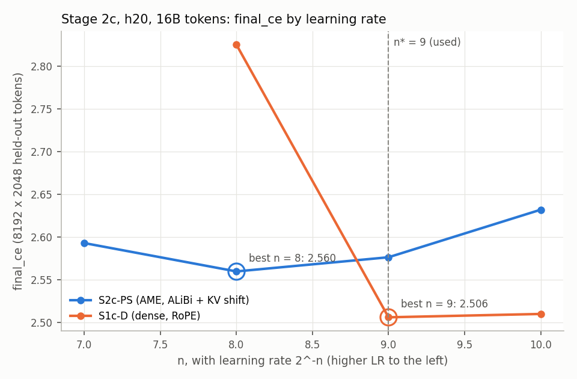
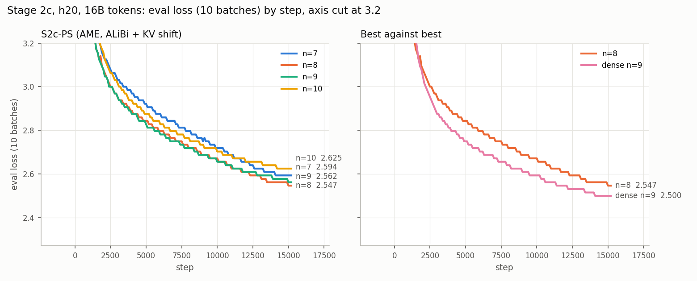

# Stage 2c — the best AME variant at h20: report

**Status: complete (2026-11-10 08:40). S2c-PS's best learning rate is n = 8, inside its
grid of n = 7 to 10: `final_ce` 2.5596. That is 0.054 above dense's best (S1c-D at n = 9,
2.5059), and at n = 9 AME is 0.070 above dense ([Result](#result)). At h12 and h16 the
gaps were 0.143 and 0.115 best against best, so at h20 the gap is about half. The runs
moved from Helios to LEM at 18:16 on 2026-11-08, at Maciej's instruction; no Helios job
had started ([stage_1c_report.md](stage_1c_report.md), decision 6). The grid of n = 8, 9
and 10 and the extension n = 7 ran on LEM from 02:43 to 23:53 on 2026-11-09, all from
commit `a8553b7e`. n = 11 was cancelled before it started (decision 8).**

The plan is [ame_experiments.md, "Stage 2c — the best AME variant at h20"](ame_experiments.md#stage-2c--the-best-ame-variant-at-h20).
This file is its record: every job, result and decision, each with its reason. Times are
CET. Stage 1c, which supplies the dense h20 baseline and n_d\*, is
[stage_1c_report.md](stage_1c_report.md). That report also holds what the two stages share:
the Helios compile fix, the pre-flight and the submission method. Stage 2b's record, the
same arm at h16, is [stage_2b_report.md](stage_2b_report.md).

## Result

| | S2c-PS, AME h20 with ALiBi and the KV shift |
|---|---|
| Learning rates trained | n = 7, 8, 9, 10 |
| `final_ce` | 2.5928 / **2.5596** / 2.5762 / 2.6318 |
| Best by the plan's rule (lowest `final_ce`) | **n = 8**, inside the grid once n = 7 was added past its edge |
| n = 8's margin | over n = 9: 0.0166 in `final_ce`, 0.0177 in paired train loss over the last 500 steps; over n = 7: 0.0332 and 0.0335 |
| Gap to dense at n_d\* = 9 | **+0.070**: 2.5762 against S1c-D's 2.5059 |
| Gap, best against best | **+0.054**: n = 8's 2.5596 against S1c-D's best, 2.5059 at n = 9 |

- **n = 8 took the lead late, at 71–74% of the run.** It trailed n = 9 by 0.013–0.014 at
  32–44% of the run, drew level at 71–74%, and then led by more each window, to 0.018 at
  the end ([Progress](#progress)). From 57% of the run to the end it gained 0.027 on
  n = 9. That is twice what the higher LR gained over the same stretch in Stage 1c
  (0.013), and close to h16's late gain (0.026 from 42%).
- **Both measures agree, and the margin is well above their precision.** `final_ce` can
  be off by up to ±0.008 per run, since it averages per-batch losses rounded to bf16. The
  paired train-loss gap, over 500 steps of the same batches, has a standard error of
  0.0005.
- **The curve is shallow on both sides of n = 8.** One step up in LR, n = 7, costs 0.033;
  one step down, n = 9, costs 0.017; two steps down, n = 10, costs 0.072. No AME run
  stalled. Dense at n = 8 did, and lost 0.319 ([stage_1c_report.md](stage_1c_report.md)).
- **AME's best LR is one step above dense's**, at h20 as at h16: n = 8 against n = 9. At
  h12 both were best at n = 8.
- **n = 7 was needed, and n = 11 was not.** n = 7 started early, before n = 8's lead
  showed (decisions 9–11). n = 11 was cancelled while pending once the grid was set
  (decision 8), and was never needed: n = 10 trailed n = 9 throughout and ended 0.056
  behind.

**Against Stages 2 and 2b**, the plan's table:

| Gap, PS − dense | h12, 4B | h16, 8B | h20, 16B |
|---|---:|---:|---:|
| At n = 9 | +0.162 | +0.152 | **+0.070** |
| Best against best | +0.143, both at n = 8 | +0.115; neither arm's best was bracketed | **+0.054**; AME at n = 8, dense at n = 9, both bracketed |

| | h12, 4B | h16, 8B | h20, 16B |
|---|---:|---:|---:|
| AME (S2-PS, S2b-PS, S2c-PS): best n; `final_ce` | 8; 3.1250 | 8; 2.8594 | 8; 2.5596 |
| AME at n = 9 | 3.1865 | 2.8965 | 2.5762 |
| Dense with RoPE: best n; `final_ce` | 8; 2.9824 | 9; 2.7441 | 9; 2.5059 |
| Dense at n = 9 | 3.0244 | 2.7441 | 2.5059 |
| AME's parameters, × dense's | 6.0× | 5.6× | 5.1× |
| Tokens per dense parameter | 21.8 | 22.6 | 25.8 |
| GPUs per run; precision | 1; autocast bf16 | 1; autocast bf16 | 4; FSDP2 mixed precision |

- **The gap about halves at h20.** Best against best it went from +0.143 to +0.115 between
  h12 and h16, then to +0.054 at h20. At n = 9 it went from +0.162 to +0.152, then to
  +0.070. The first scale step moved it by 0.01–0.03, the second by 0.06–0.08.
- **AME gains more per scale step than dense.** Dense's best loss fell by 0.238 at each
  step ([stage_1c_report.md](stage_1c_report.md)). AME's fell by 0.266 and then 0.300.
- **This is not yet a clean scaling result.**
  - h20 changes more than size: 4 GPUs with FSDP2 mixed precision instead of 1 GPU with
    autocast, and 25.8 tokens per dense parameter instead of 22.6. Both arms share the
    change, but nothing shows that it affects them equally.
  - Each cell has one seed. No scale has a second seed of AME with ALiBi and the shift, or
    of dense with RoPE. The only measured seed gap, 0.232 at h12, is for the position-free
    S1-A0, and says little about these arms ([stage_2_report.md](stage_2_report.md)).
  - Neither arm's best was bracketed at h16: dense at n = 8 and AME at n = 7 were not
    tried there. At h12, dense gained 0.042 from n = 9 to n = 8, while AME lost at n = 7,
    as it did at h20. So h16's +0.115 more likely understates its gap than overstates it,
    which would make the drop to h20 larger.
- **What the comparison does not match**, as the plan lists:
  - AME has 5.1× dense's parameters, 3.16B against 620M, and does 0.95× its FLOPs per
    token, 3.7683 against 3.9646 GFLOP;
  - the positional signal is ALiBi with the shift, against RoPE;
  - AME's banks are exempt from weight decay, while the dense W_Q and W_K are not.

**Readouts at the end of training**, read from each final checkpoint with
[documents/scripts/ame_ckpt_readouts.py](../scripts/ame_ckpt_readouts.py) and averaged over
the 20 layers. FSDP2 kept them out of W&B. Attention entropy and top-8 mass need a forward
pass, so they are left out, as the plan says.

| Run | n | τ, mean | Shortest horizon | α₂, mean \|·\| | β₂, mean \|·\| |
|---|---:|---:|---:|---:|---:|
| S2c-PS, h20 | 7 | 8.31 | 10.8 (5.0 and 5.3 in layers 4 and 8) | 0.579 | 1.035 |
| S2c-PS, h20 | **8** | 8.59 | 14.1 | 0.586 | 0.833 |
| S2c-PS, h20 | 9 | 8.51 | 14.8 | 0.550 | 0.672 |
| S2c-PS, h20 | 10 | 8.24 | 15.2 | 0.423 | 0.683 |
| S2b-PS, h16 | 8 | 8.53 | 14.8 | 0.550 | 0.725 |
| S2b-PS, h16 | 9 | 8.33 | 15.0 | 0.454 | 0.669 |

- **The script reproduces Stage 2b's logged readouts** from the h16 checkpoints, to the
  digits shown. At n = 9 it reads 8.33, 15.05, 0.454 and 0.670, against 8.33, 15.0, 0.454
  and 0.669 logged; W&B's last log falls a few steps before the end.
- **The shift is kept**, with β₂ above α₂ at every n, as at h12 and h16. The higher the LR,
  the more the model leans on it: β₂ is 0.67–0.68 at n = 9 and 10, 0.83 at n = 8 and 1.03
  at n = 7, and α₂ rises from 0.42 at n = 10 to 0.58–0.59 at n = 7 and 8.
- **τ stays near its init value of 8**, at 8.2–8.6 on average. So the ALiBi ladder keeps
  its reach: the shortest horizon is 14–15 tokens at n = 8 to 10, against 16 at init.
- **At n = 7 the near-local head shortens.** Head 0 of layers 4 and 8 reaches 5.0 and 5.3
  tokens, at τ 2.5 and 2.7.
- **At n = 8 one head went almost content-blind**: head 18 of layer 2, τ 0.23 against 8 at
  init.
  - Its content scores span at most ±0.23, so it attends by position alone. Its horizon
    fell from 5,902 tokens to 168.
  - The same head has layer 2's lowest τ at n = 9 (3.44) and at n = 10 (7.24). At h16 too,
    layer 2's lowest-τ head is a long-range one (4.71 at n = 8).
  - Every other head at h20 keeps τ at 2.49 or above.

*Top: `final_ce` against n, for AME and, for reference, for dense from Stage 1c. The rings
mark each arm's lowest point, and the dashed line is n_d\* = 9, which set this stage's
grid. Dense's n = 8 point is its stall. Bottom: eval loss on 10 batches by step, with the
y-axis cut at 3.2 to show the second half of the run. Left are the four AME runs; right,
AME's best against dense's best. Both were made with
[documents/scripts/stage_results.py](../scripts/stage_results.py) (`sweep`, `curves`).*

**The runs.** Each has seed 123, 16.00B tokens in 15,259 steps, 3,163,200,720 parameters
(2,575,564,800 in the banks), 3.7683 GFLOP/token and 4 H100 on LEM. Each is its own submit
from commit `a8553b7e`, with config
[configs/stage_2c/ame_h20_pe_shift.yaml](../../configs/stage_2c/ame_h20_pe_shift.yaml) and
`trainer.learning_rate=<n>`, in its own cemetery clone.

| n | LR | `final_ce` | Last 10-batch eval | Loss spikes (train) | s/step | MFU | Peak GiB | Wall time | Job | Snapshot | W&B run |
|---:|---:|---:|---:|---|---:|---:|---:|---:|---|---|---|
| 7 | 7.81e-3 | 2.5928 | 2.5938 | none | 3.011 | 33.2% | 64.66 | 13 h 29 m | 6285238 | `a7774a4` | `40cdf2te` |
| 8 | 3.91e-3 | **2.5596** | 2.5469 | none | 3.001 | 33.3% | 64.74 | 13 h 28 m | 6284092 | `8c39f4e` | `tg4h4g66` |
| 9 | 1.95e-3 | 2.5762 | 2.5625 | none | 2.990 | 33.4% | 64.74 | 13 h 26 m | 6275194 | `2b81091` | `g3gw9wru` |
| 10 | 9.77e-4 | 2.6318 | 2.6250 | steps 130–157 → 8.69 | 2.997 | 33.3% | 64.66 | 13 h 26 m | 6277615 | `fa49ac9` | `5xclzzfy` |

- **s/step is the median over steps ≥ 100**, as in the earlier reports, so it leaves out
  the steps that carry an eval. With them, the mean is 3.14–3.16 s, 31.6–31.8% MFU. MFU is
  computed offline against 4 × 989 TFLOP/s. Dense ran at 42.3–42.6% on the same cluster.
- **A spike** is a step whose train loss exceeds the median of the previous 50 by more
  than 0.5. n = 10's came in warmup, and it recovered.
- **Every run exited with code 0**, logged `final_ce` over 8192 × 2048 held-out tokens,
  and wrote its final checkpoint, 38 GB each: 4 FSDP2 shards of 1.76 GB and each GPU's
  bank shard of 7.73 GB. They are kept on LEM, under
  `/lustre/pd03/plgrid/plgllmefficont3/nano/plgmstefaniak/llmrandom_cemetery/`, at
  `<clone>/checkpoint/<job>/0/step_15258`. The clones are
  `s2c_ps_h20_lr7.0_2026-11-09_08-50-16`, `s2c_ps_h20_lr8.0_2026-11-09_06-05-44`,
  `s2c_ps_h20_lr9.0_2026-11-08_18-35-25` and `s2c_ps_h20_lr10.0_2026-11-08_20-23-24`.

**Cost.** The four runs used 215.3 GPU-h on LEM, at 13.4–13.5 h each:
- 161.3 GPU-h for the grid of n = 8, 9 and 10, against the plan's estimate of about 175;
- 53.9 GPU-h for the extension n = 7, against about 58.

The smoke run used 0.7 GPU-h. On Helios nothing of Stage 2c started, and n = 11 never
started.

## Setup

| | |
|---|---|
| Question | How far is AME's best variant, ALiBi with the KV shift, from dense at h20 and 16B tokens? And does the gap keep shrinking with scale? |
| Arm | S2c-PS, one arm only (Maciej, 2026-11-07): S2b-PS on Stage 1c's model, recipe and hardware. `shift: true`, so α and β are learned per head and layer; the slopes are unset, so AME uses its ALiBi ladder, horizons 16 to 8,192 tokens over 20 heads; `bank_gate: none` |
| Code and configs | Commit **`a8553b7e`** on branch `stage1c2c_lem`, the same as Stage 1c: `683c316b`'s code plus the config commit that moves both stages to LEM (`ame_main`'s `acb68ff5`, cherry-picked), submitted from `~/code/nano-stage1c2c` ([stage_1c_report.md](stage_1c_report.md), decision 7). Since Stage 2b's `89975bbf`, AME gained the bank-gates option (`157c3122`), off by default: with `bank_gate: none` the layer computes what it did in Stage 2b (only the q/k reshape moved after the gather) and draws nothing more from the RNG. The trainer gained readouts only (`train/clip_factor`, `train/grad_norm/banks`) and opt-in token counts, which are off; the clip itself is unchanged |
| Config | [configs/stage_2c/ame_h20_pe_shift.yaml](../../configs/stage_2c/ame_h20_pe_shift.yaml), `learning_rate: null`, set per run as `trainer.learning_rate=<n>`. One submit is one run |
| Cluster, recipe | Stage 1c's: LEM since 18:16 on 2026-11-08, one node of 4 H100 per run with r16-11 excluded, FSDP2 with `reshard_after_forward: false`, bf16 from FSDP2's mixed precision, micro-batch 16 × 8 per GPU, 15,259 steps = 16.00B tokens, warmup 152, seed 123, 24 h limit. The banks are column-sharded over the 4 GPUs (`mem_parallel_size: 4`) |
| Learning rate | n = 9 alongside Stage 1c; then n_d\* − 1, n_d\* and n_d\* + 1 around Stage 1c's best n, extended past an edge if needed. Stage 1c gave n_d\* = 9, so n = 8, 9 and 10; n = 7 was added past the edge (decisions 9–12) |
| W&B | `ideas_cv/nano-ame`, runs `s2c_ps_h20_lr<n>.0`, tag `stage_2c` |

**Model**, built on the meta device ([stage_1c_report.md](stage_1c_report.md), pre-flight):
3,163,200,720 parameters, of which 2,575,564,800 are banks, 458,857,680 backbone and
128,778,240 embedding and head; 3.7683 GFLOPs per token at seq 2048. That is 5.1× the
dense model's 620.35M parameters, and the banks alone are 4.2×; the FLOPs per token are
0.95× dense's. *(Corrected on 2026-11-10: this sentence first said the banks alone were
5.1×.)*

**What the comparison with dense matches and what it does not:**

| Matched | Not matched |
|---|---|
| tokens, data order (4 GPUs) | total parameters: AME has 5.1× |
| recipe, precision path, hardware | FLOPs per token: AME does 0.95× |
| | positional signal: ALiBi with the shift, against RoPE |

**Weight decay differs between the arms.** AME's Q/K banks are exempt from weight decay,
while the dense W_Q and W_K are not
([archive/ame_review_and_fixes.md](archive/ame_review_and_fixes.md) 2.6). Every AME-vs-dense
number in this file carries that difference.

**Readouts.** FSDP2 is on, so α₂, β₂, τ, the horizons and the attention entropy are not
logged: each AME layer's `instrumentation()` fails once with a warning and is dropped
([src/core/trainer.py](../../src/core/trainer.py), `_log_layer_instrumentation`). No fix had
reached `ame_main` by `683c316b`. So α₂, β₂ and τ are read from each final checkpoint, and
attention entropy and top-8 mass are left out, as the plan says.

## Jobs

| Job | What | n | W&B run | Node | Submitted | Started | Ended | State | `final_ce` |
|---|---|---:|---|---|---|---|---|---|---:|
| 25862201 | Helios 4-GPU smoke: the S2c-PS file, 60 steps | 9 | — | — | 01:14 | never | 18:16 | cancelled, never started | — |
| 25862255 | Helios **S2c-PS** | 9 | — | — | 01:15 | never | 18:16 | cancelled, never started | — |
| 6274942 | LEM 4-GPU smoke: the S2c-PS file, 60 steps | 9 | `yss8c50l` | r16-15 | 18:23 | 18:23 | 18:34 | completed | 7.3535 (60 steps) |
| 6275194 | **S2c-PS** | 9 | `g3gw9wru` | r18-9 | 18:35 | 11-09 02:43:01 | 11-09 16:09:00 | completed | 2.5762 |
| 6277615 | **S2c-PS** | 10 | `5xclzzfy` | r10-11 | 20:23 | 11-09 06:02:52 | 11-09 19:28:53 | completed | 2.6318 |
| 6282280 | **S2c-PS** | 11 | — | — | 11-09 02:50 | never | 11-09 07:29 | cancelled, never started (decision 8) | — |
| 6284092 | **S2c-PS** | 8 | `tg4h4g66` | r14-12 | 11-09 06:06 | 11-09 08:36:55 | 11-09 22:04:57 | completed | **2.5596** |
| 6285238 | **S2c-PS** | 7 | `40cdf2te` | r18-11 | 11-09 08:50 | 11-09 10:23:52 | 11-09 23:52:47 | completed (decisions 9–11) | 2.5928 |

## Smoke run

**On Helios: cancelled before it started.** Job 25862201 was submitted at 01:14 with the
real runs, was still pending at 18:16, and was cancelled with the move to LEM.

**On LEM: job 6274942**, `smoke_s2c_ps_h20_lr9`, the S2c-PS file run from `a8553b7e`. It
uses `trainer.learning_rate=9 trainer.n_steps=60 trainer.eval_interval=20` and a 1.5 h
limit, with r16-11 excluded, and was submitted at 18:23, before the real run
([stage_1c_report.md](stage_1c_report.md), decision 8). It checks:
- that micro-batch 16 fits under FSDP2 with the banks sharded over 4 H100s (93.6 GiB each;
  64.63 GiB peak on entropy, §1.15);
- the s/step against the plan's 3.14–3.25, which was estimated for LEM;
- that `final_ce` is logged and the checkpoint written (backbone shards and each GPU's bank
  shard);
- that the readouts fail with a warning per layer while the run goes on.

**Results: every check passes.** The job completed with exit code 0 in 10 min 30 s on
r16-15 (W&B `yss8c50l`):

| Check | Result | Plan |
|---|---|---|
| Peak memory | **64.63 GiB**, the same as on entropy (§1.15) | under LEM's 93.6 |
| s/step, median over steps 15–59 | **2.964**, steady at 2.94–2.97 between evals | 3.14–3.25 |
| Eval cost | about 16–21 s each: steps 21 and 41 took 24.3 and 18.9 s | — |
| `final_ce` after 60 steps | 7.3535 | logged |
| Checkpoint | 37,964,561,848 bytes: 4 FSDP2 backbone shards (1.76 GB each), each GPU's bank shard `memory_parallel_rank<k>.pt` (7.73 GB each), the metadata and the training state | about 37 GB |
| Readouts | 80 warnings, one per layer on each of the 4 ranks ("instrumentation … failed and is disabled for the rest of this run"); no AME readout keys in W&B; the run went on | one warning per layer |

- **2.964 s/step is 354k tokens/s, 33.7% MFU** against 4 × 989 TFLOP/s, computed offline. It
  is 1.21× dense's 2.443 on the same nodes.
- **Whole-run estimate on LEM: about 13.4 h**, which fits the 24 h limit with 1.8× margin:
  - 15,259 steps × 2.964 s = 12.6 h;
  - 152 evals × about 18 s = 0.75 h;
  - about 6 min to start, then `final_ce` and the checkpoint.
- The checkpoint was deleted at 18:35:05.

## Progress

**08:50: n = 8 has started, and n = 10 trails n = 9 by 0.063 at 19% of the run.** The table
shows train-loss means over 200-step windows at matched steps. All the runs see the same
data in the same order, so the gaps are paired.

| Steps | n = 9 | n = 10 | n = 10 − n = 9 |
|---|---:|---:|---:|
| 200–399 | 4.7528 | 5.3213 | +0.5685 |
| 1,000–1,199 | 3.5035 | 3.6130 | +0.1095 |
| 1,400–1,599 | 3.3592 | 3.4480 | +0.0888 |
| 1,800–1,999 | 3.2679 | 3.3456 | +0.0777 |
| 2,200–2,399 | 3.2052 | 3.2777 | +0.0725 |
| 2,600–2,799 | 3.1580 | 3.2231 | +0.0651 |
| 2,800–2,999 | 3.1384 | 3.2017 | +0.0633 |

- **n = 10 trails in every window**, by less each time, but more slowly: the gap fell by
  0.014 over the last 1,000 steps. Its 10-batch eval loss at step 3,000 is 3.0156,
  against n = 9's 2.9531.
- **h16 says the gap will not close.** There S2b-PS's n = 10 trailed n = 9 by 0.070 at 19%
  of the run and by 0.065–0.068 at 42–68%, and ended 0.072 behind (`final_ce` 2.9688
  against 2.8965). So n = 10 should not end best, and n = 11 is not queued.
- **n = 10 spiked once, in warmup**: steps 130–157, to 8.69 from a running median of 5.62.
  n = 9 has no spike in 6,900 steps.
- **n = 8 started at 08:36:55 on r14-12** (W&B `tg4h4g66`) and trains at 2.99 s/step, as
  the other two do.
  - It has no spike through step 175, past the 152-step warmup. Stage 1c's dense n = 8
    spiked inside its warmup and then stalled.
  - Its 50-step means, 7.66 and 6.42 over steps 0–99, sit with n = 9's 7.73 and 6.35.
- **Expected ends**, at the 3.14 s/step mean the runs show with evals: n = 9 at about
  16:10, n = 10 at about 19:30 and n = 8 at about 22:05.

**10:25: n = 7 started, with n = 8 level with n = 9 and closing.** n = 7 started at
10:23:52 on r18-11 (W&B `40cdf2te`). By then n = 8 had trained 1,967 steps, 13% of its run.

| Steps | n = 8 | n = 9 | n = 8 − n = 9 |
|---|---:|---:|---:|
| 200–399 | 4.7523 | 4.7528 | −0.0005 |
| 400–599 | 4.1400 | 4.1227 | +0.0173 |
| 600–799 | 3.8090 | 3.7992 | +0.0098 |
| 800–999 | 3.6247 | 3.6176 | +0.0071 |
| 1,000–1,199 | 3.5079 | 3.5035 | +0.0044 |
| 1,200–1,399 | 3.4237 | 3.4189 | +0.0048 |
| 1,400–1,599 | 3.3641 | 3.3592 | +0.0049 |
| 1,600–1,799 | 3.3115 | 3.3101 | +0.0014 |

- **n = 8 has been within 0.01 of n = 9 since step 600**, and the gap is closing: 0.017 at
  steps 400–599, 0.004–0.005 at 1,000–1,599, 0.001 at 1,600–1,799.
- **It is ahead of h16's path.** At h16, n = 8 trailed n = 9 by 0.035 at 11–13% of the
  run, drew level only at 18–21% and ended 0.037 ahead. Here it is level at 10–12%.
- **The 10-batch eval losses are equal** at steps 1,400–1,700 and 1,900. At step 1,800, n = 8
  is two bf16 steps behind: 3.1406 against 3.1094.
- **n = 8 has no spike** in its 1,992 steps.

**16:30: n = 9 finished at 2.5762, and n = 8 trails it by 0.009 at 57% of the run.** The
table shows train-loss means over 200-step windows at matched steps, which are paired. The
percentage is each window's midpoint as a share of the run's 15,259 steps.

| Steps | % | n = 7 | n = 8 | n = 9 | n = 10 | n = 8 − n = 9 | n = 10 − n = 9 |
|---|---:|---:|---:|---:|---:|---:|---:|
| 1,600–1,799 | 11 | 3.3818 | 3.3113 | 3.3101 | 3.3937 | +0.0012 | +0.0836 |
| 3,000–3,199 | 20 | 3.2094 | 3.1292 | 3.1217 | 3.1831 | +0.0075 | +0.0614 |
| 4,800–4,999 | 32 | 3.0983 | 3.0200 | 3.0066 | 3.0558 | +0.0134 | +0.0492 |
| 6,600–6,799 | 44 | 3.0197 | 2.9435 | 2.9303 | 2.9753 | +0.0132 | +0.0450 |
| 7,800–7,999 | 52 | — | 2.9016 | 2.8920 | 2.9337 | +0.0096 | +0.0417 |
| 8,600–8,799 | 57 | — | 2.8745 | 2.8654 | 2.9079 | +0.0091 | +0.0425 |
| 11,600–11,799 | 77 | — | — | 2.7858 | 2.8358 | — | +0.0500 |

- **n = 9 completed at 16:09:00, exit code 0.**
  - `final_ce` 2.5762; its last 10-batch eval, at step 15,200, was 2.5625.
  - No spike in 15,259 steps.
  - 2.990 s/step, 33.4% MFU, peak 64.74 GiB.
  - 13.42 h of W&B runtime, 13 h 26 min in the job.
  - Against dense at the same n, 2.5059, the gap is **+0.070**. It was +0.152 at h16 and
    +0.162 at h12. Best against best waits for the other runs.
- **n = 8 has not overtaken n = 9, as it did at h16.**
  - The gap opened from +0.001 at 11% of the run to +0.013–0.014 at 32–44%. It has
    narrowed since, to +0.009 at 57%.
  - Their 10-batch evals are equal at steps 8,600 and 8,900, at 2.7031 and 2.6875.
  - In Stage 1c the higher LR gained 0.014 on its neighbour from 45% of the run to the end.
    A late gain like that would leave n = 8 and n = 9 level, within `final_ce`'s ±0.008
    precision. So n = 8 may still end best.
- **n = 7 trails n = 9 by 0.089, and n = 8 by 0.076**, at 44% of the run. It has no spike
  in 6,899 steps, and it will not end best.
- **n = 10 trails n = 9 by 0.042–0.045 from 40% to 60% of the run**, and by more as the LR
  decays: 0.050 at 77%. It will not end best.
- **n = 8 has no spike** in 8,936 steps. n = 10's warmup spike, steps 130–157, is still its
  only one.
- **Expected ends:** n = 10 at about 19:30, n = 8 at about 22:05, and n = 7 at about 23:55.

**Ends.** n = 10 finished at 19:28:53, n = 8 at 22:04:57 and n = 7 at 23:52:47 on
2026-11-09, each with exit code 0. They were read at 08:22 on 2026-11-10 (decision 12).
The last windows, at matched steps:

| Steps | % | n = 7 | n = 8 | n = 9 | n = 10 | n = 8 − n = 9 |
|---|---:|---:|---:|---:|---:|---:|
| 10,800–10,999 | 71 | 2.8589 | 2.8050 | 2.8043 | 2.8514 | +0.0007 |
| 11,200–11,399 | 74 | 2.8452 | 2.7917 | 2.7932 | 2.8421 | −0.0015 |
| 12,800–12,999 | 85 | 2.7889 | 2.7474 | 2.7572 | 2.8090 | −0.0098 |
| 15,000–15,199 | 99 | 2.7452 | 2.7118 | 2.7294 | 2.7874 | −0.0176 |
| Last 500 steps, paired | | 2.7472 | 2.7137 | 2.7314 | 2.7879 | −0.0177 |

## Decisions

1. **The n = 9 run was submitted at 01:15, alongside Stage 1c's grid**, as the plan
   allows. n = 9 is in Stage 2c's grid whichever of 8, 9 or 10 Stage 1c picks, and it was
   n\* at h12 and h16, so it is the like-for-like point across the three scales. The other
   two runs wait for Stage 1c's best n, or for its leader to be clear mid-run.
2. **Moved to LEM with Stage 1c at 18:16** ([stage_1c_report.md](stage_1c_report.md),
   decisions 6–8). Helios jobs 25862201 and 25862255 never started and were cancelled. On
   LEM the smoke run goes first, then n = 9, which still runs alongside Stage 1c's grid
   for the reason in decision 1. Both stages stay on one cluster, as the plan requires.
3. **S2c-PS at n = 9 was submitted at 18:35, as soon as the AME smoke run passed.** It
   waits in LEM's queue with Stage 1c's grid ([stage_1c_report.md](stage_1c_report.md),
   decision 9).
4. **S2c-PS at n = 10 was submitted at 20:23, before Stage 1c's best n is known.**
   - **n = 10 is in the grid whichever of 9, 10 or 11 Stage 1c picks.** The grid is
     n_d\* − 1, n_d\* and n_d\* + 1. Stage 1c's n = 8 can no longer be best: at step 2,000
     it is 2.1 nats behind n = 9 ([stage_1c_report.md](stage_1c_report.md), decision 10).
     This is the plan's reason for starting n = 9 early, applied once n = 8 dropped out.
   - **Only n_d\* ≥ 12 would leave n = 10 out.** For that, n = 10 must beat n = 9, and then
     n = 11 must beat n = 10. Dense's best was n = 8 at h12 and n = 9 at h16. If it
     happens anyway, the run is one more grid point, about 58 GPU-h.
   - **Waiting would cost queue age.** On LEM, age adds about 59 priority points an hour
     (weight 10,000, full after about 7 days; n = 9 had 105 after 1.8 h). So five hours of
     age equal our whole fairshare term, 303. Meanwhile the queue moves: between 18:40 and
     20:20, Slurm moved n = 9's forecast from 2026-11-09 08:28 to 2026-11-10 04:11.
   - **The third run waits:** n = 8 if n_d\* = 9, n = 11 if n_d\* = 10.
   - **It runs on the same code.** It was submitted with the same script from the worktree
     at `a8553b7e`, adding `trainer.learning_rate=10`. Its clone's `src` and `configs`
     trees match those of `a8553b7e` and of the n = 9 clone, and its config differs from
     n = 9's only in `learning_rate`.
5. **The third run still waits (2026-11-09 00:30).** Stage 1c's n = 10 leads n = 9 by
   0.012 a window, steadily since step 3,600 ([stage_1c_report.md](stage_1c_report.md),
   decision 12).
   - **That lead is enough for Stage 1c's early start of n = 11**, which costs one dense
     run if it is wrong.
   - **It does not yet make the leader clear for Stage 2c.** At h16, the gaps between
     neighbouring n moved by up to 0.014 after 40% of the run, about the size of this lead.
   - **A wrong guess here costs a 58 GPU-h AME run on the wrong side of the grid.** The
     third run is n = 11 if n_d\* = 10, and n = 8 if n_d\* = 9.
   - **Waiting costs little.** The run would queue behind Stage 2c's n = 9 and 10 and
     Stage 1c's n = 11, which are all older.
   - **Next check:** at about 03:00, when n = 10 is about 60% through. Otherwise when n = 9
     and n = 10 finish, at about 06:00 and 07:30.
   - **The snapshots of n = 9 and 10 carry two stale grid configs**, which are never
     read ([stage_1c_report.md](stage_1c_report.md), decision 12).
6. **S2c-PS at n = 11 was queued at 02:50 on 2026-11-09, as job 6282280, before Stage 1c's
   best n is certain.**
   - **Stage 1c's n = 10 is likely to end best.** At 58% of its run it leads n = 9 by
     0.010, and it has led in every 200-step window since step 200. The lead narrows by
     about 0.0005 per 1,000 steps, so at that pace n = 10 ends about 0.007 ahead
     ([stage_1c_report.md](stage_1c_report.md), Progress, 02:50).
   - **It is not certain.** At h16, late in the run, the higher-LR run of a neighbouring
     pair gained up to 0.012 on the lower one. Here the higher-LR run is n = 9, 0.010
     behind.
   - **Queue position matters more than decision 5 assumed.** It expected the run to queue
     only behind our own older jobs. In fact 146 tasks of other users, 197 GPUs in all,
     wait between our n = 10 (priority 895) and Stage 1c's n = 11 (646). A job queued now
     starts at 515 and gains about 59 an hour. So each hour of waiting lets the jobs
     others queue in that hour go ahead of it.
   - **A pending job can be cancelled at no cost.** n = 11 queues behind all of those, so
     it should still be pending when Stage 1c's n = 9 and n = 10 finish, at about 06:05
     and 07:25.
   - **If Stage 1c's n = 9 ends best, n = 11 is cancelled and n = 8 submitted.** The grid
     is then 8, 9 and 10, and n = 11 would be needed only if AME's best landed on n = 10,
     that grid's edge. At h16, AME's best n was one below dense's
     ([stage_2b_report.md](stage_2b_report.md)).
   - **n = 8 may be needed even if Stage 1c's n = 10 ends best**, as the edge extension,
     if AME's best lands on n = 9. Stage 2c's own results decide that, one run at a time.
   - **It runs on the same code.** Its clone is `s2c_ps_h20_lr11.0_2026-11-09_02-49-43`,
     snapshot `499879a`:
     - its `src` and `configs` trees are those of `a8553b7e` and of n = 10's clone;
     - its config differs from n = 10's only in `learning_rate`, and its `exp.job` not at
       all;
     - its snapshot holds only `config_0.yaml`, since the submit now clears the directory
       first.
7. **S2c-PS at n = 8 was queued at 06:06 on 2026-11-09, as job 6284092.**
   - **Stage 1c's n = 10 lost its lead as the LR decayed.** It fell from 0.010 at 57% of
     its run to nothing at 83%, and at 86–87% n = 9 led by 0.0002–0.0004
     ([stage_1c_report.md](stage_1c_report.md), Progress, 06:05). So n = 9 may end best,
     and then this stage's grid is 8, 9 and 10.
   - **n = 8 is likely needed either way.** If Stage 1c's n = 10 ends best, n = 8 is the
     edge extension should AME's best land on n = 9. At h16, AME's best n was one below
     dense's ([stage_2b_report.md](stage_2b_report.md)).
   - **Queuing now is free and keeps its place**, as in decision 6. It ranks behind Stage
     1c's n = 11, this stage's n = 11 and about 150 tasks of other users.
   - **At Stage 1c's n = 10 finish, about 07:25:**
     - if n = 9 has the lower `final_ce`, n = 11 (6282280) is cancelled while pending and
       n = 8 stays;
     - if n = 10 has, n = 11 stays. n = 8 then stays queued while AME's n = 9 leads its
       n = 10 mid-run, the plan's early start for an edge, and is cancelled while pending
       once AME's n = 10 leads clearly.
   - **It runs on the same code.** Its clone is `s2c_ps_h20_lr8.0_2026-11-09_06-05-44`,
     snapshot `8c39f4e`. Its `src` and `configs` trees are `a8553b7e`'s, its config differs
     from n = 10's only in `learning_rate`, its `exp.job` not at all, and its snapshot
     holds only `config_0.yaml`.
8. **The grid is n = 8, 9 and 10 (07:29 on 2026-11-09).** Stage 1c's n = 10 finished at
   07:24 with `final_ce` 2.5098, above n = 9's 2.5059, so n_d\* = 9
   ([stage_1c_report.md](stage_1c_report.md), decision 14).
   - **n = 11, job 6282280, was cancelled at 07:29, before it started**, as decision 7 set
     out. It is outside the grid, and would be needed only if AME's best landed on n = 10,
     the grid's edge.
   - **n = 8, job 6284092, stays queued**, since it is now in the grid. Slurm forecasts its
     start at 13:15.
   - **All three runs use the same code**, from the worktree at `a8553b7e` (decisions 4, 6
     and 7).
   - **Next: the edge rule.** If n = 10 ends best, n = 11 is added; if n = 8 does, n = 7.
     As in Stage 1c, each extension starts early, once the edge leads mid-run.
9. **S2c-PS at n = 7 was queued at 08:50 on 2026-11-09, as job 6285238, ahead of the
   evidence.**
   - **n = 8, the grid's lower edge, may well end best.** S2-PS and S2b-PS were both best at
     n = 8, at h12 and h16. At h16 n = 8 beat n = 9 by 0.037. If n = 8 ends best here, the
     plan adds n = 7.
   - **The evidence comes late.** At h16, n = 8 trailed n = 9 by 0.035 at steps 800–999,
     11–13% of the run. It drew level by steps 1,400–1,599, 18–21% (+0.001), and led from
     steps 2,000–2,199, 26%, by more each window, to 0.037 at the end. A higher learning
     rate gains as the LR decays, as in Stage 1c. Here 26% is step 3,970, about 12:10.
   - **Queuing now is free and keeps its place**, as in decisions 6 and 7. A pending job is
     cancelled at no cost, and the wait is long: n = 8 waited 2.5 h for a node, and Stage
     1c's n = 11, queued at 00:34, reached the head of the queue only by 07:28.
   - **Holding it would not keep its place.** LEM sets no `ACCRUE_ALWAYS` priority flag, so
     a held job stops gaining age priority.
   - **The rule.** n = 8 and n = 9 are compared at matched steps when n = 7 starts, and at
     each check after.
     - n = 7 runs, the plan's early start for an edge, if n = 8 leads n = 9. It also runs
       if n = 8 is level with n = 9, within 0.01 and closing, as at h16 at 19%.
     - Otherwise n = 7 is cancelled at once. If it is still pending, that costs nothing;
       if it has just started, it costs under 1 GPU-h. It is resubmitted once n = 8 leads.
     - n = 7 is also cancelled if n = 8 stalls, as Stage 1c's dense n = 8 did. The same
       holds if, past 20% of its run, n = 8 trails n = 9 by more than 0.04 and the gap is
       not closing. 0.04 is h16's late swing.
   - **It runs on the same code.** Its clone is `s2c_ps_h20_lr7.0_2026-11-09_08-50-16`,
     snapshot `a7774a4`. Its `src` and `configs` trees are `a8553b7e`'s, its config
     differs from n = 8's only in `learning_rate`, its `exp.job` not at all, and its
     snapshot holds only `config_0.yaml`.
   - **Cost if it runs:** about 58 GPU-h, the plan's estimate for an extension. LEM's grant
     has used 28,481 of its 100,000 GPU-h.
10. **n = 7 runs (10:25 on 2026-11-09).** It started at 10:23:52, sooner than Slurm's 13:25
    forecast. Decision 9's rule lets it run, since n = 8 is level with n = 9 and closing:
    0.0014 behind at steps 1,600–1,799, down from 0.017 at 400–599 (Progress, 10:25).
    - **It is not yet a lead**, so the rule is checked again at each later window, as
      decision 9 says. n = 7 is cancelled if n = 8 stalls, or if from 20% of its run,
      step 3,052 and about 11:20, n = 8 trails n = 9 by more than 0.04 without closing.
    - **The next check is at 16:30, not 11:20**, at Maciej's instruction (10:33): the runs
      look stable, so polling is less frequent. By 16:30 n = 8 is about 58% through, and
      n = 9 has finished.
11. **n = 7 runs to its end, whatever n = 8's final (16:30 on 2026-11-09).**
    - **n = 8 may still end best.** It trails n = 9 by 0.009 at 57% of the run and is
      closing, well inside decision 9's 0.04. A late gain like Stage 1c's would leave the
      two level (Progress, 16:30). Then n = 7 is what brackets n = 8.
    - **If n = 9 ends best instead**, n = 7 is not needed for the bracket. But it will be
      87% done when n = 8 finishes, at about 22:05. Finishing costs about 7 GPU-h and gives
      the curve a fourth `final_ce`.
    - **n = 11 is not needed.** n = 10 trails n = 9 by 0.042–0.050 from 40% of its run, and
      by more as the LR decays.
    - **The next check is a single one, at about 00:05**, after n = 7's expected end, since
      Maciej asked for less frequent polling. No decision falls before then: n = 10's and
      n = 8's finals change nothing that is running.
12. **S2c-PS's best n is 8, inside its grid, and Stage 2c is complete (08:40 on
    2026-11-10).**
    - **n = 8 has the lowest `final_ce`**, 2.5596: 0.017 below n = 9 and 0.033 below n = 7.
      The paired train loss over the last 500 steps agrees, at 0.0177 and 0.0335.
    - **n = 8 was the grid's lower edge.** n = 7, added by the edge rule and started early
      (decisions 9–11), brackets it. So the plan's condition holds, the best n lying inside
      the grid of n = 7 to 10, and no further run is needed.
    - **Decision 11's reading held.** n = 8 gained 0.027 on n = 9 from 57% of the run to
      the end, and took the lead at 71–74%.
    - **The 00:05 check did not run.** The session watching the runs ended before then,
      and the runs were read at 08:22, after all four had finished. Nothing waited on that
      check: no job of this stage was pending.
    - **The final checkpoints are kept**, the final checkpoint only, as the plan has it.
      The smoke run's checkpoint was deleted at 18:35:05 on 2026-11-08.
    - **n = 7's own result does not stop it.** If it spikes or stalls, as Stage 1c's dense
      n = 8 did, it still runs to the end. The record needs its `final_ce`, and a worse one
      at n = 7 is what brackets n = 8. Stage 1c kept its stalled n = 8 on the first ground
      ([stage_1c_report.md](stage_1c_report.md), decision 10).

## For Maciej

- **The AME–dense gap about halves at h20.** Best against best it is +0.054, against
  +0.115 at h16 and +0.143 at h12; at n = 9 it is +0.070 ([Result](#result)). If this goes
  into the paper, two runs would firm it up:
  - a second seed of S2c-PS at n = 8 and of S1c-D at n = 9, about 54 and 45 GPU-h on LEM.
    No scale has a seed replicate of either arm;
  - dense at n = 8 and AME at n = 7 on h16, Stage 2b's open items
    ([stage_2b_report.md](stage_2b_report.md), "For Maciej" 3). They would bracket both of
    h16's bests and settle the gap there.
- **AME wants a learning rate one step above dense's**, at h16 and at h20: n = 8 against
  n = 9. A larger AME run should center its grid one step above dense's best.
- **One head at n = 8 went almost content-blind.** Head 18 of layer 2 has τ 0.23, so it
  attends by position over about 168 tokens, yet n = 8 is the best run. The same head has
  layer 2's lowest τ at n = 9 and 10 too. A forward pass on the final checkpoint would
  show what it does, and would also give the attention entropy and top-8 mass the plan
  left out.
- **The final checkpoints stay on LEM** until you say otherwise: 152 GB for the four AME
  runs, 38 GB each, and 21 GB for Stage 1c's three dense runs. The paths are in
  [Result](#result).
- **The worktree `~/code/nano-stage1c2c` is kept** at `a8553b7e`, on branch
  `stage1c2c_lem`, as the earlier stages' worktrees were. A seed replicate can run from it
  on the same code. Remove it with `git worktree remove ~/code/nano-stage1c2c` when it is
  no longer needed; the branch keeps the commit.
